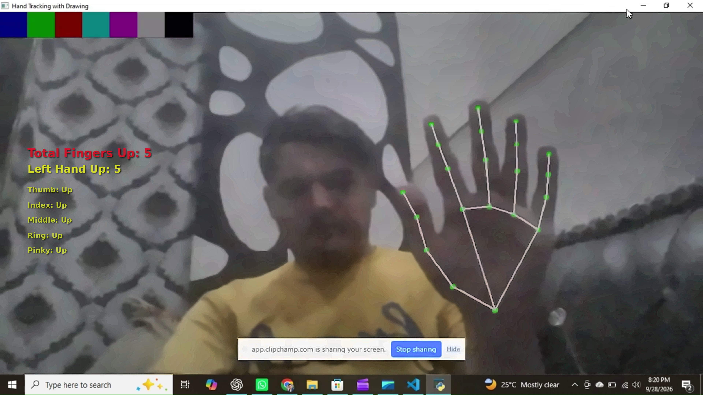
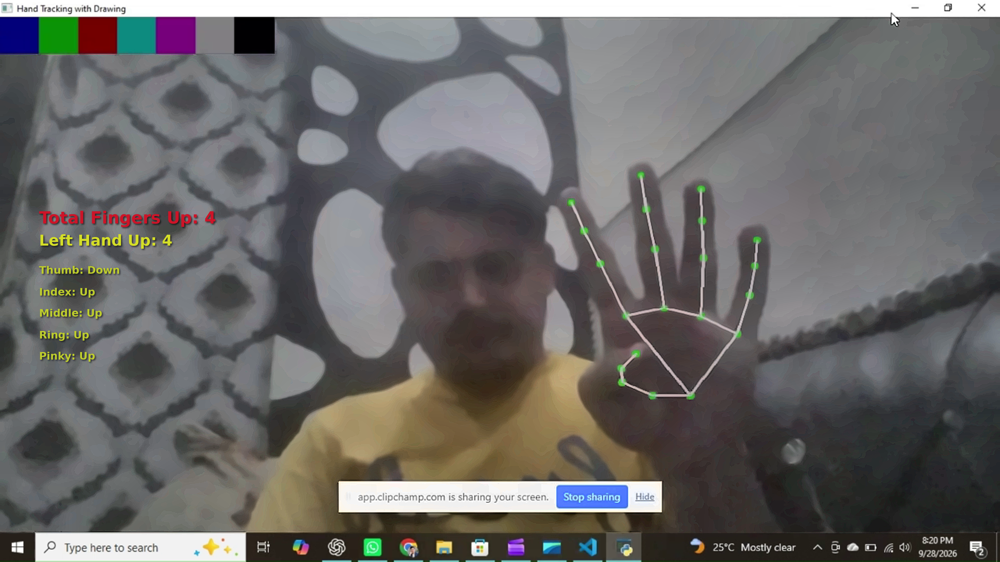
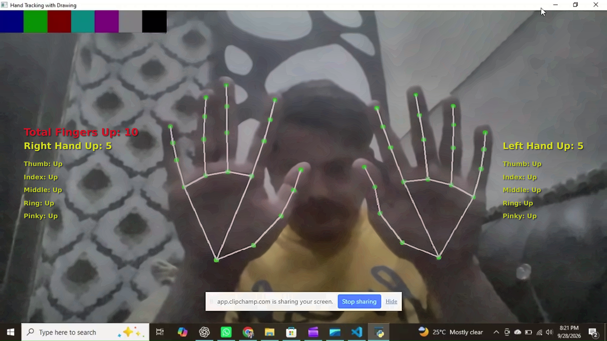
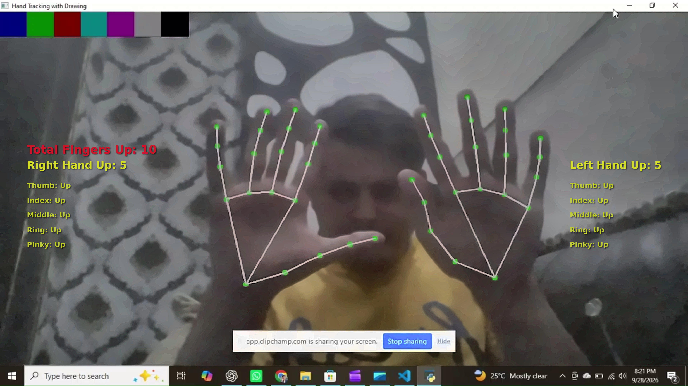
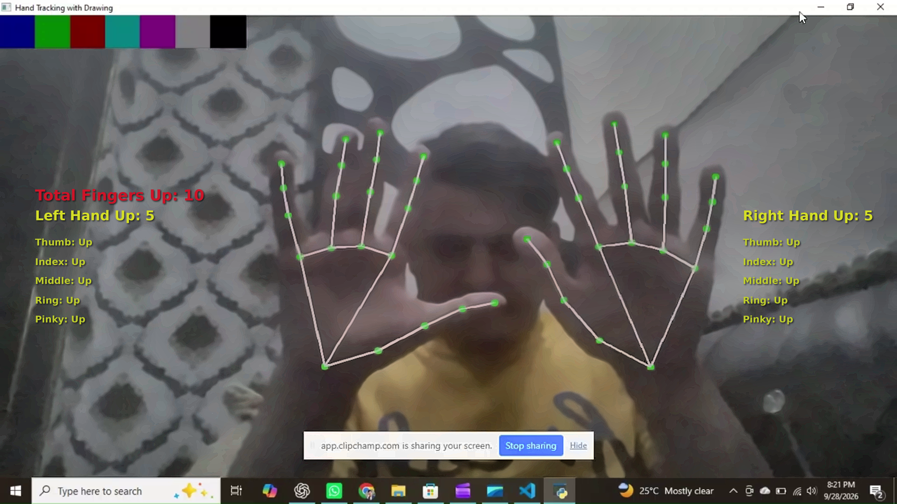

<div align="center">

# 🖐️ Hand and Finger Tracking with Virtual Drawing

### Real-Time Hand Landmark Detection, Finger Tracking, Gesture Analysis & Virtual Drawing

<p>
  
  
  
  
  
</p>

<p>
  <a href="#-overview">Overview</a> •
  <a href="#-key-features">Features</a> •
  <a href="#-project-workflow">Workflow</a> •
  <a href="#-installation-and-setup">Installation</a> •
  <a href="#-demo-and-screenshots">Demo</a> •
  <a href="#-developer">Developer</a>
</p>

</div>

---

## 📌 Overview

This project implements a real-time **Hand and Finger Tracking System** using Python, MediaPipe, and OpenCV.

**The application captures live webcam video, detects up to two hands, identifies their 21 hand landmarks, and analyses individual finger positions using joint-angle calculations.**

**In addition to hand landmark detection, the system performs finger-level analysis to identify raised and bent fingers, calculate the number of raised fingers, and display individual finger statuses.**

**The application also includes a virtual drawing feature that allows users to draw on the screen using their index fingertip and select different colours through an interactive colour palette.**

**The project combines computer vision, hand landmark detection, finger tracking, gesture analysis, and interactive drawing in a single application.**

## 🎯 Project Objectives

- Implement real-time hand detection and landmark tracking.
- Track individual fingers using MediaPipe hand landmarks.
- Identify whether fingers are raised or lowered.
- Detect bent fingers through joint-angle calculations.
- Count raised fingers on individual hands and across detected hands.
- Track the index fingertip for interactive drawing.
- Develop a virtual drawing interface using OpenCV.

---

## 🚀 Key Features

| Feature | Description |
|---|---|
| 🖐️ Hand Detection | Detects up to two hands through the webcam. |
| 📍 Hand Landmark Tracking | Identifies and visualizes 21 landmarks per detected hand. |
| ☝️ Individual Finger Tracking | Analyses the thumb, index, middle, ring, and pinky fingers. |
| 📐 Finger Angle Calculation | Calculates joint angles to determine finger positions. |
| ⬆️⬇️ Finger Status Recognition | Displays each finger as Up or Down. |
| 🔢 Finger Counting | Calculates raised fingers for each hand and the combined total. |
| 🤏 Bent Finger Detection | Identifies bent fingers using joint-angle conditions. |
| 🎨 Virtual Drawing | Draws on a digital canvas using the index fingertip. |
| 🌈 Colour Selection | Selects drawing colours through the on-screen palette. |
| 🧹 Canvas Clearing | Clears the virtual drawing canvas using a keyboard shortcut. |
| ⌨️ Keyboard Controls | Provides controls for tracking, drawing, and exiting. |

---

## 🧠 Hand and Finger Tracking

**The project combines two related computer vision functionalities.**

### 1. Hand Tracking

**The MediaPipe Hand Landmarker detects hand landmarks and identifies their positions in the webcam frame.**

**Each detected hand contains 21 landmarks representing important hand joints and fingertip positions.**

**The application:**

- Detects up to two hands.
- Retrieves hand landmark coordinates.
- Identifies handedness when available.
- Draws landmark points and connecting lines.
- Visualizes the detected hand structure.

### 2. Finger Tracking

**The system analyses five individual fingers:**

| Finger | Landmark Indices |
|---|---|
| Thumb | 1, 2, 3, 4 |
| Index | 5, 6, 7, 8 |
| Middle | 9, 10, 11, 12 |
| Ring | 13, 14, 15, 16 |
| Pinky | 17, 18, 19, 20 |

**Finger positions are evaluated using joint-angle calculations.**

**Finger Status Logic:**

- Angle greater than 150° → Finger classified as Up.
- Otherwise → Finger classified as Down.

**The program also checks two angles for each finger and displays a bent-finger label when both angles are below 85°.**

**Note: These are the angle-based conditions implemented in the current program.**

---

## 📊 Project Workflow

```text
          START APPLICATION
                 |
                 ▼
          Initialize Libraries
                 |
                 ▼
       Load MediaPipe Hand Model
                 |
                 ▼
          Open Webcam Camera
                 |
                 ▼
          Capture Video Frame
                 |
                 ▼
          Detect Hand Landmarks
                 |
                 ▼
       ┌───────────────────────┐
       │    Hand Tracking      │
       │                       │
       │  • Detect Hands       │
       │  • Identify Landmarks │
       │  • Draw Hand Skeleton │
       └───────────────────────┘
                 |
                 ▼
       ┌───────────────────────┐
       │   Finger Tracking     │
       │                       │
       │  • Analyse 5 Fingers  │
       │  • Calculate Angles  │
       │  • Detect Up / Down  │
       │  • Detect Bent State │
       │  • Count Fingers     │
       └───────────────────────┘
                 |
                 ▼
       ┌───────────────────────┐
       │   Virtual Drawing     │
       │                       │
       │  • Track Index Tip    │
       │  • Select Colour     │
       │  • Draw on Canvas    │
       └───────────────────────┘
                 |
                 ▼
          Display Output
                 |
                 ▼
          Next Video Frame
```

---

## 🎨 Virtual Drawing System

**The application uses the index fingertip to control the virtual drawing interface.**

### Drawing Functionality

- Tracks the index fingertip using landmark 8.
- Draws on a separate digital canvas.
- Uses the selected colour for drawing.
- Allows colour selection through the top colour palette.
- Combines the webcam frame and drawing canvas for the final output.

### Available Colours

**The current program includes seven drawing colours:**

- Blue
- Green
- Red
- Yellow
- Magenta
- White
- Black

---

## ⌨️ Keyboard Controls

| Key | Function |
|---|---|
| `Q` | Exit the application. |
| `T` | Enable or disable hand tracking. |
| `D` | Enable or disable virtual drawing. |
| `C` | Clear the drawing canvas. |

---

## 🛠️ Technologies Used

| Technology | Purpose |
|---|---|
| Python | Main programming language. |
| OpenCV | Webcam access, image processing, drawing, and display. |
| MediaPipe | Hand landmark detection and handedness information. |
| NumPy | Canvas creation and numerical array operations. |
| Math | Joint-angle calculations. |

---

## 📂 Recommended Repository Structure

```text
Hand-and-Finger-Tracking-with-Virtual-Drawing/
│
├── hand-tracking.py
├── hand_landmarker.task
├── requirements.txt
├── README.md
│
└── assets/
    ├── screenshots/
    │   ├── hand-detection.png
    │   ├── hand-landmarks.png
    │   ├── finger-tracking.png
    │   ├── finger-counting.png
    │   └── virtual-drawing.png
    │
    └── demo/
        └── hand-finger-tracking-demo.gif
```

**This is a recommended structure. The screenshots and GIF should be added to the repository when available. The program automatically downloads the MediaPipe model if it is not already present.**

---

## ⚙️ Installation and Setup

### 1. Clone the Repository

```bash
git clone https://github.com/shahidazam2020-oss/Hand-and-Finger-Tracking-with-Virtual-Drawing.git
```

### 2. Navigate to the Project Directory

```bash
cd Hand-and-Finger-Tracking-with-Virtual-Drawing
```

### 3. Create a Virtual Environment

```bash
python -m venv venv
```

Activate it on Windows:

```bash
venv\Scripts\activate
```

### 4. Install Dependencies

```bash
pip install opencv-python numpy mediapipe
```

### 5. Run the Application

```bash
python hand-tracking.py
```

**Requirements:**
- Python environment.
- Working webcam.
- Internet connection on the first run if the MediaPipe model file is not already available.

---

## 🖼️ Demo and Screenshots

**Add actual application screenshots and a short animated GIF to demonstrate the system.**

| Screenshot | Description |
|---|---|
| Hand Detection | Live detection of one or two hands. |
| Hand Landmarks | Visualization of the 21 hand landmarks. |
| Finger Tracking | Individual finger status detection. |
| Finger Counting | Display of raised fingers. |
| Virtual Drawing | Drawing using the index fingertip. |

---
## 📸 Screenshots

| Screenshot 1 | Screenshot 2 |
|---|---|
|  |  |
| Screenshot 1  | Screenshot 2 |

| Screenshot 3 | Screenshot 4 |
|---|---|
|  |  |
| Screenshot 3 | Screenshot 4 |

| Screenshot 5 | Screenshot 6 |
|---|---|
|  |  |
| Screenshot 5 | Screenshot 6  |


---

## 📚 Learning Outcomes

**Through this project, the following concepts are explored:**

- Real-time computer vision applications.
- Hand detection and landmark localization.
- Individual finger tracking and analysis.
- Joint-angle calculation.
- Basic gesture and finger-state recognition.
- Webcam-based interactive applications.
- Virtual drawing and image overlay techniques.
- Integration of MediaPipe and OpenCV.

---

## 🔮 Future Improvements

**Potential enhancements include:**

- More advanced hand gesture recognition.
- Improved finger-state classification.
- Gesture-based drawing activation.
- Separate drawing controls for both hands.
- Save and export virtual drawings.
- Additional drawing tools and colour options.
- Improved tracking performance and stability.

---

## 👨‍💻 Developer

### Shahid Azam

**MS Computer Science | Artificial Intelligence | Python Development**

Institute of Management Sciences, Peshawar, Pakistan

<p>
  <a href="https://github.com/shahidazam2020-oss">
    
  </a>
  <a href="https://www.linkedin.com/in/shahid-azam-mughal-787b58235">
    
  </a>
  <a href="https://www.researchgate.net/profile/Shahid-Azam-5">
    
  </a>
  <a href="https://orcid.org/0009-0001-6825-8863">
    
  </a>
</p>

</div>

---

## 📄 License

This project is available for educational and learning purposes. Add a LICENSE file to the repository if you intend to distribute it under a specific open-source license.


---
**Suggestions, improvements, and contributions are welcome.**

1. Fork this repository.
2. Create a new branch.
3. Make your changes.
4. Submit a pull request.


<div align="center">

### ⭐ If you find this project interesting, consider giving the repository a star!

**Built with Python, MediaPipe, and OpenCV.**

</div>
